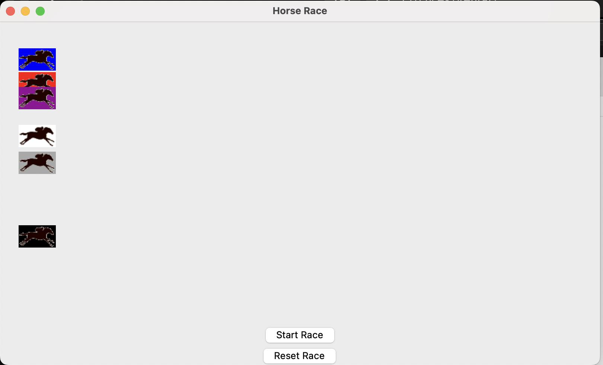
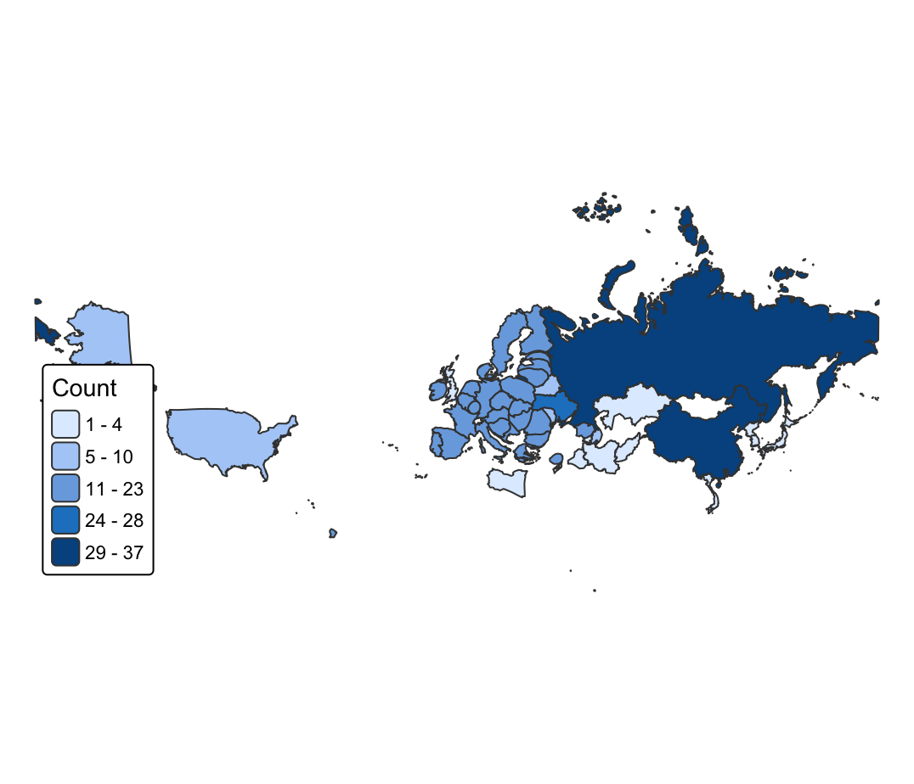
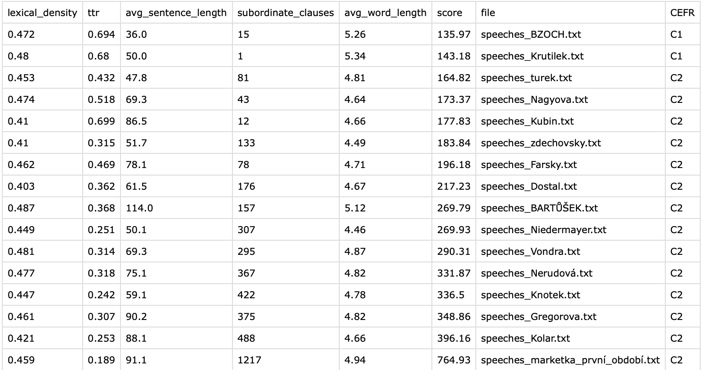

---title: Listopad až červen
description: Zápisky za dlouhou dobu
slug: cerven2026
date: 2026-07-12 00:00:00+0000
tags:
    - Journal Entry
weight: 1
---

# Zápisky za dlouhou dobu (Listopad 2025 až Červen 2026)

Tohle se bude repredukovat hůře. Za tu dobu jsem byl na koncertě Young Leana (perfektní), Leye Lofaje (fakt mě bavilo, ale má méně hudby a chybělo mi, že tam nebyli žádný skeletonovky). Dál jsem teď byl na koncertě Tylera Durdena, což bylo spíš takový zkontrolování, že žije. Ale energie super, jen těch písniček mohlo být víc. 

Z dalších kulturních akcí jsem byl na premieře Přeživat Derridu, což vůbec nebylo špatný. Byl jsem v divadle na Dlouhým dnem do noci (perfektní), Zničit a Veřejných nepřátelích (tj hodně Houellebecq jaro). Napsal jsem dvě jednoaktovky do školy, jsou takový meh, ale mě to bavilo (a mám v plánu psát divadelních her fakt hodně. Jen nejprve musím dostudovat).

Hodně jsem poslouchal hudbu, teď zrovna poslouchám AnDy Darling - cold war star. Mluvil jsme v Buchtách, což vyjde někdy v Srpnu. Můj poslech podcastů se uzpůsobil v poslech Datařů, Questu, Buchet a pak někdy když mě něco zaujme. 

Postoval jsem nějaký přispěvky na socky o republikanismu, ale moc to lidi nezajímá :D 

## Co se týká programování?

1. Udělal jsem mapu pro INN predatorských služeb. Obecně jsem na tom trochu pracoval, vylepšoval svůj scrapper a viewer, který už skoro rok běží a sbírá data. A už se s nimi dělají i analýzy, jupíííííí. Potřebuju víc datových zdrojů a půjde to.

2. Udělal jsem si maličký dostih. Abych mohl sledovat malé dostihy, kdykoliv nemám co dělat. Je to primitivní a z části navibecodovaný (stydím se za to)



3. Udělal jsem analýzu zemí, co zmiňuje Marketa Gregorová (a taky jejich nejčastějších slov)

Viz:



Když už jsem u toho byl, tak jsem si napsal kód, co zjišťuje úroveň angličtiny jednotlivých MEPs



4. Napsal jsem scrapper pro majetek státu (tj co stát prodává), ale není to na 100 % nasazený. Vlastně mi u toho došlo, že mě nenapadá k čemu by to bylo dobrý, i když se tam prodávaly ty bitcoiny, takže možná pro nějaké novináře? Chceš to, pošlu ti to!!!

5. Hrál jsem si s AI, napsal jsem RAG nad cyberzákonem, ale je to pomalý, protože mám slabší počítač. Taky jsem napsal RAG nad zákoníkem práce, nad marxovým životním dílem... prostě mám v počítači pár zajímavejch RAGů. Toho marxe proháním všemi lyrics kapely kabát, takže vychází fakt zajímavý texty. 

6. Pár úprav na Kramerius scrapperu, zatím se stále zdá, že funguje aspoň pro MZK, a NDK taky chvílemi. 

7. Začal jsem se učit Rust a Assembly, protože nevím, s pythonem patlám takový paltaloviny.

8. Napsal jsem svůj search engine suggestion getter (prostě se dívá na search suggestions na DDG a Google) -> plán je tak mapovat nějaký věci přes rok, podobně jako Michal Kašpárek.

9. Napsal jsem kod, co prochází wikipedii, a hledá kde končí první odkazy, když je budeš sledovat do první repetice. Je to zábavná hračka, pustím si youtube video a pak se kouknu, co to našlo :D

```python
import requests
from bs4 import BeautifulSoup
import re
from multiprocessing import Pool, freeze_support
from tqdm import tqdm
import time
from collections import Counter

NUMBER_OF_PAGES = 1000

HEADERS = {
    "User-Agent": "Mozilla/5.0"
}

WIKI_BASE = "https://en.wikipedia.org"
RANDOM_PAGE = "https://en.wikipedia.org/wiki/Special:Random"

def getFirstAnchor(soup, current_url):
    content = soup.find("div", class_="mw-body-content")
    if not content:
        return None

    for p in content.find_all("p"):
        if not p.text.strip():
            continue
        for a in p.find_all("a", href=True):
            href = a.get("href")

            if not href.startswith("/wiki/"):
                continue

            if ":" in href: 
                continue

            full_url = "https://en.wikipedia.org" + href

            if full_url != current_url:
                return full_url

    return None

def crawl_recursive(url, path=None):
    if path is None:
        path = []

    if url in path:
        path.append(url)
        return path

    path.append(url)

    try:
        response = requests.get(url, headers=HEADERS)
        soup = BeautifulSoup(response.content, "html.parser")
        next_url = getFirstAnchor(soup, url)
    except Exception:
        return path

    if not next_url:
        return path

    return crawl_recursive(next_url, path)


def get_random_article():
    for _ in range(5):
        response = requests.get(
            RANDOM_PAGE,
            headers=HEADERS,
            allow_redirects=True
        )
        if "Special:Random" not in response.url:
            return response.url


def process_page(_):
    print(f"Start {_}", flush=True)
    start = get_random_article()
    path = crawl_recursive(start)
    print(f"Done {_}", flush=True)
    return {
        "start": start,
        "length": len(path),
        "end": path[-1],
        "path": path
    }

if __name__ == "__main__":
    endings =[]
    freeze_support()
    with Pool(processes=5) as pool:
        results = [pool.apply_async(process_page, args=(i,)  ) for i in range(NUMBER_OF_PAGES)]
        with tqdm(total=NUMBER_OF_PAGES) as pbar:
            completed = 0
            while completed < NUMBER_OF_PAGES:
                completed = sum(r.ready() for r in results)
                pbar.n = completed
                pbar.refresh()
                time.sleep(1)

        final_results = [r.get() for r in results]
    endings = []
    for res in final_results:
        endings.append(res["end"])
        """
        print("Start:", res["start"])
        print("Length:", res["length"])
        print("End:", res["end"])
    
        print("Full Path", res["path"])
        print("-" * 50)
        """
    print(Counter(endings).most_common(10))


 ```

 10. Napsal jsem si kod, co běží při poslechu spotify a každejch pár pisniček zahlási nahrané hlášky. Takže mi doma simuluje rádio <333333 Jen potřebuju někoho, kdo mi namluví dobrý hlášky o všem a ničem zároveň.

 A to je asi všechno :( moc toho není, protože se blíží odevzdání diplomky. A napsal jsem pár long readů.

 Zase někdy!